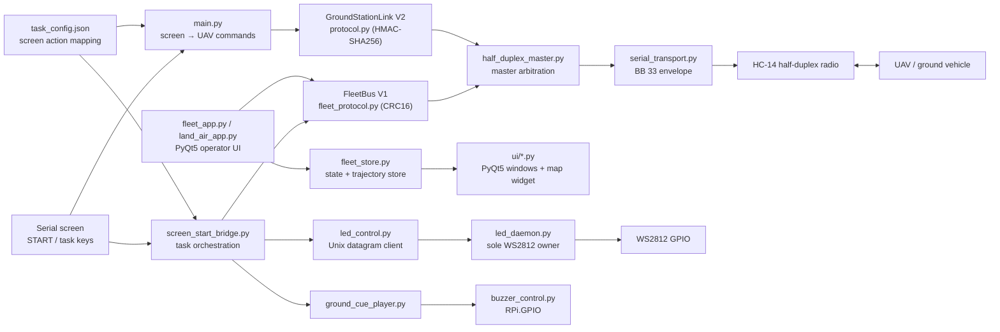
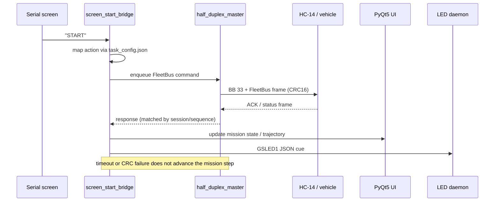

# System Architecture — Ground Station

> **Scope**: software architecture of the Raspberry Pi ground station, derived from
> source code at `main` = `c6ab3ba76a7625c3501710473faf6c2ff133b1b4` (2026-08-17).
> It documents what the code does, not a claim that a specific field run succeeded.

## 1. Purpose and boundary

The ground station is the operator console for the "land–air collaborative" D-task:
it maps physical screen-button presses (`START`, task keys) and UI actions into
FleetBus commands for the UAV and the ground vehicle, shows telemetry/trajectories,
and drives WS2812 LEDs and a buzzer for operator cues.

Two independent link stacks exist in this repository and **must not be conflated**:

| Stack | Code | Frame integrity | Used by |
|---|---|---|---|
| FleetBus V1 | `components/fleet_protocol.py` | `CRC16-CCITT-FALSE` | D-task runtime: `screen_start_bridge.py`, `land_air_app.py`, `fleet_app.py` |
| GroundStationLink V2 | `components/protocol.py` | HMAC-SHA256 tag | `main.py` (screen → UAV command bridge) |

`land_air_app.py` actively rejects configuration keys named `hmac`, `key`,
`secret` or `password` (L14, L26), which is consistent with FleetBus V1 carrying
no HMAC. **There is no "all frames are HMAC" property in the D-task path.**

## 2. Diagram A — system panorama

## 3. Diagram B — one START cycle (FleetBus V1)

## 4. Component evidence

| Component | Role | Input / output | Evidence @ `c6ab3ba7` | Status |
|---|---|---|---|---|
| `main.py` | Screen command → UAV command bridge using GroundStationLink V2 | screen chars → HMAC frames | `main.py` L7-L21 | legacy/alternate path |
| `components/screen_start_bridge.py` | Orchestrates the D-task START sequence, owns mission state, drives UI | screen + config → FleetBus commands | L23-L29, L693-L776 | production |
| `components/land_air_app.py` | Read-only FleetBus ground display + task coordination | FleetBus frames → store/UI | L1, L76-L77, L122 | production |
| `components/fleet_app.py` | Generic FleetBus UI application | FleetBus frames → PyQt5 | L88 | production |
| `components/fleet_protocol.py` | FleetBus V1 framing, CRC16, session/sequence/ACK cache | bytes ↔ `Frame` | L86-L174 | production |
| `components/half_duplex_master.py` | Serializes half-duplex request/response traffic | command queue ↔ transport | — | production |
| `components/serial_transport.py` | pyserial transport with `BB 33` envelope | frame ↔ bytes | — | production |
| `components/protocol.py` | GroundStationLink V2 with HMAC-SHA256 | frame + key ↔ bytes | L60, L89-L108 | legacy/alternate |
| `components/fleet_store.py`, `state_store.py`, `trace_sync.py` | State, trajectory and trace synchronization | frames → in-memory state | — | production |
| `components/ui/*.py` | PyQt5 windows, map widget, target dialog | store → screen | `ui/fleet_main_window.py` 等 | production |
| `components/led_control.py`, `led_daemon.py` | WS2812 control; daemon is the only GPIO owner | Unix datagram `GSLED1:` JSON | `docs/architecture.md` §LED | production |
| `components/ground_cue_player.py`, `buzzer_control.py` | Abstract cue player; GPIO only via callback | events → LED client + buzzer callback | `docs/architecture.md` §蜂鸣器 | production |
| `components/config.py` | Station settings + HMAC key loading (V2 only) | JSON / env → settings | L27-L40 | production |
| `deploy/`, `tools/` | systemd/desktop templates, autostart scripts | — | — | deployment |

## 5. Runtime entry points

- `python main.py` — screen-driven command bridge (GroundStationLink V2 / HMAC).
- `python components/land_air_app.py` — D-task read-only display + coordination.
- `python components/fleet_app.py` — generic FleetBus operator UI.
- `python components/led_daemon.py` — always-on LED daemon (started by systemd).
- `python components/screen_start_bridge.py` — full START workflow with UI.

## 6. Safety and failure behaviour

- `half_duplex_master.py` serializes access to the half-duplex radio; the ground
  station is the bus master.
- `fleet_protocol.py` rejects CRC mismatches (`ProtocolError("crc")`), tracks
  `crc_failures`, and deduplicates commands by session/sequence.
- `led_daemon.py` is the only process that writes the WS2812 GPIO; other processes
  send datagrams over a Unix socket, avoiding timing corruption.
- `buzzer_control.py` imports `RPi.GPIO` lazily and treats `enabled: false` as a
  safe no-op, so the station can run on a non-Pi development machine.
- The D-task FleetBus path has **no authentication tag**; treat the radio link as
  a trusted local link, not as an Internet-exposed service.

## 7. Validation and limitations

- Protocol facts above were verified against `fleet_protocol.py` (CRC16) and
  `protocol.py` (HMAC) source, and against `DDDDDDRONE/details.md` which states
  FleetBus V1 does not use HMAC.
- `docs/architecture.md` currently says "所有帧都带 HMAC 认证"; that statement is
  true only for the GroundStationLink V2 path and should be corrected/qualified
  when the README is revised.
- No claim is made about measured link range, latency, or field success rates.
- The repository has **no root LICENSE**.

## 8. Related documents

- `docs/architecture.md` — existing architecture note (data flow, LED daemon, buzzer)
- `docs/configuration.md` — station/task configuration
- `README.md` — installation, HMAC key setup (V2), troubleshooting
